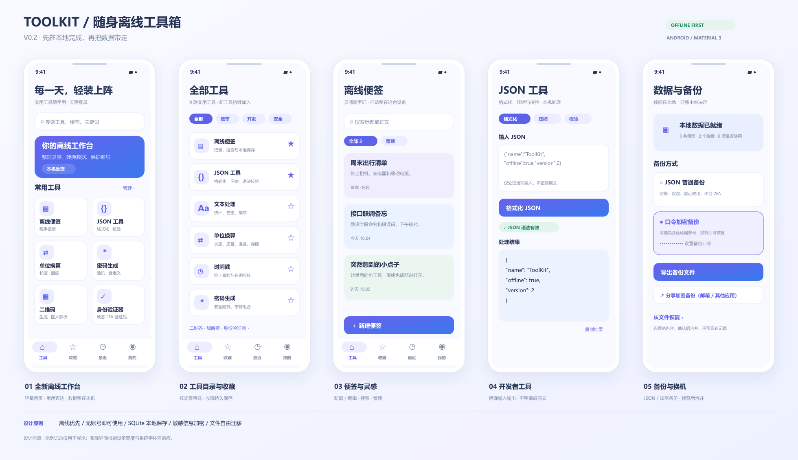

# 安卓工具箱

基于 Kotlin / Jetpack Compose 的 Android 离线工具箱，当前版本 **0.2.0**。



完整功能、数据库结构、备份格式、迁移流程与后续路线见 [离线版设计与实现](docs/offline-v2.md)。原版设计保留在 `docs/toolbox-prototype.png`。

## 功能

- 九款工具：离线便签、JSON 格式化 / 压缩 / 校验、文本处理、单位换算、密码生成、时间戳、二维码、加解密、2FA 验证器。
- 首页分类搜索、可修改收藏、最近使用；便签支持编辑、搜索、置顶与删除。
- SQLite 保存便签、收藏、最近使用、设置与 Keystore 加密的验证器账号；兼容迁移旧版 OTP 本地数据。
- 普通 JSON 导出不含验证器密钥；口令加密备份可选包含验证器账号，可通过系统分享面板交给邮箱等应用。
- 导入先解密校验、展示预览，经用户确认后在数据库事务中合并；相同备份重复导入不会重复增加记录。
- 二维码生成、图片解析、各计算工具无需联网；相机扫码沿用 Google Code Scanner，依赖 Google Play 服务，首次可能下载模块。
- 加解密新增 AES-128 / AES-256（CBC、PKCS7），直接使用自定义的 16 / 32 字节 UTF-8 密钥，实时显示字节数；原 AES-256-GCM 的口令、派生方式与 `v1:` 密文格式保持兼容。
- AES / RSA 加密完成后可点击「保存到便签」，保存完整密文并自动标注算法；保存成功后可在离线便签中查看，不保存密钥或原文。
- 身份验证器支持按平台名 / 账号名搜索；可扫描、从多张图片或粘贴链接导入 Google Authenticator 批量迁移二维码，收齐后预览并确认合并。导出可勾选账号，自动分页生成 Google 兼容二维码，并逐张保存或分享。使用说明和兼容范围见 [身份验证器迁移](docs/authenticator-migration.md)。

## 本地数据与换机

数据库通过 `Context.getDatabasePath("toolbox.db")` 存在 Android 应用私有目录，并非 APK 安装目录。便签为普通本地数据，2FA 密钥使用 Android Keystore AES-GCM 额外加密。

换机推荐：我的 → 口令加密备份 → 可选包含验证器账号 → 导出到应用外 / 系统分享 → 新手机选择文件 → 输入原口令 → 预览 → 确认合并。备份口令无法找回；卸载或清除应用数据前请先导出。自动系统备份继续关闭，避免恢复设备绑定的密文却缺失原 Keystore 密钥。

## 构建与验证

需要 JDK 17、Android SDK Platform 36，使用 Android Studio 打开本目录。首次构建需下载 Gradle / Maven 依赖。

```powershell
.\gradlew.bat testDebugUnitTest assembleDebug assembleDebugAndroidTest lintDebug
# 连接设备或启动模拟器后：
.\gradlew.bat connectedDebugAndroidTest
```

Debug 安装包：`app/build/outputs/apk/debug/app-debug.apk`。

2026-11-03 验证：13 项 JVM 测试通过，Debug APK 和设备测试 APK 编译通过；Android Lint 为 0 错误、9 警告、1 提示。设备测试尚未执行：本机未安装 Android Emulator hypervisor driver，独立模拟器无法启动，仍需实机验收。

2026-11-04 增量验证：22 项 JVM 测试通过，覆盖两种新增 AES 的独立 .NET 测试向量、随机 IV、UTF-8 密钥长度、首尾空格、错误密钥及无效密文，并验证旧 `v1:` GCM 密文兼容性。新增三种 AES 密文保存便签后关闭 / 重开数据库再解密的设备测试，设备测试 APK 编译通过；当前无连接设备，尚未执行设备测试。

2026-11-04 身份验证器更新：共 34 项 JVM 测试通过，新增搜索、独立 protobuf 协议交叉验证、批次检查、去重与 23 账号 / 3 张二维码的图像编码、扫码还原和验证码一致性验证。Debug APK、设备测试 APK 和 Lint 检查通过，Lint 为 0 错误、9 警告、1 提示；当前无连接设备，尚未与真实 Google Authenticator 双向互扫。

## 当前边界

- 不提供账号登录或自动云同步；邮箱通过用户选择的系统分享应用发送附件。
- 便签点击保存后写入数据库；加密结果可手动保存为便签，其余计算工具输入、输出及生成的密码不自动保存。
- 导入采用合并策略，便签按 UUID 和修改时间处理，不传播删除操作；具体限制见设计文档。
- 备份上限 8 MiB、5000 条便签和 1000 个验证器账号。

## ❤️ 赞赏支持

[](https://afdian.com/a/abc88)
