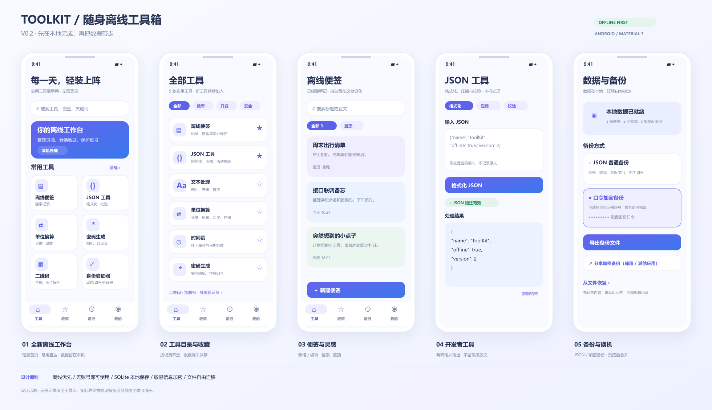

# 工具箱 0.2：离线功能、存储与迁移

2026-11-03。先完成设计图，再在现有 Kotlin / Jetpack Compose Android 项目上实现。



设计源文件：`toolbox-offline-v2.svg`；生成脚本：`render-offline-design.cjs`（Node.js + sharp）。这是设计示意图，未标注为设备运行截图。

## 本期功能

| 功能 | 已实现的行为 | 数据保存方式 |
| --- | --- | --- |
| 工具工作台 | 九款工具、分类筛选、关键词搜索 | 工具目录随应用内置 |
| 收藏 | 首页卡片和详情页均可收藏、取消 | SQLite |
| 最近使用 | 最近访问顺序、清空记录 | SQLite，仅保存工具 ID 与访问时间 |
| 离线便签 | 新建、编辑、删除、置顶、标题与正文搜索 | 点击保存后写入 SQLite；取消修改会提示 |
| JSON 工具 | 严格语法校验、两空格格式化、压缩 | 内存；保留原始数字拼写，避免大整数精度损失 |
| 文本处理 | Unicode 字符统计、行数、行去重、移除空行、行排序、大小写 | 内存 |
| 单位换算 | 长度、质量、温度、十进制 / 二进制存储单位 | 内存；BigDecimal 运算，拒绝低于绝对零度 |
| 密码生成 | 8–128 位、四类字符组合、保证包含所选类别 | SecureRandom；不自动保存；剪贴板标注敏感 |
| 时间戳 | 秒 / 毫秒与日期互转、设备时区 / UTC、填入当前时间 | 内存；严格日期校验，拒绝有歧义的夏令时本地时间 |
| 二维码 | 生成、保存、分享；新增图片离线解析 | 生成与图片解析使用内置 ZXing |
| 加解密 | AES-256-GCM、AES-128 / AES-256、RSA、Base64、SHA 摘要；加密结果可保存到便签 | 默认内存；仅点击「保存到便签」才写入完整密文 |
| 2FA | 手动、相机扫码、离线图片添加，动态验证码，删除 | Keystore AES-GCM 密文写入 SQLite |
| 数据备份 | 普通 JSON、口令加密备份、系统分享、导入预览和合并 | 用户通过系统文件选择器保存 / 读取 |

相机扫码沿用 Google Code Scanner：设备需要 Google Play 服务，首次下载扫码模块可能联网。图片解析不依赖该模块。新增工具不调用网络，不要求登录，不申请广泛存储访问权限；合并后的应用清单仍包含原扫码依赖引入的 INTERNET / ACCESS_NETWORK_STATE 权限，因此本版本不宣称完全隔绝网络。

输入限制：JSON / 文本每次最多 256000 个 UTF-16 字符；JSON 最多嵌套 64 层；便签标题最多 200 个 UTF-16 字符、正文最多 100000 个。密码长度按字符数计。

## SQLite 放在哪里

用户希望数据留在软件目录附近；Android 上应使用应用自己的私有数据目录，不能把可变数据库写进 APK 安装目录。通过 `Context.getDatabasePath("toolbox.db")` 获取实际路径，典型位置：

```text
/data/user/0/com.example.androidtoolbox/databases/toolbox.db
```

不硬编码此路径，也不要求用户直接访问该目录。覆盖升级通常保留本地数据；卸载 / 清除应用数据会删除它。因此便携备份必须导出到用户选择的应用外文件位置。依据：[Android 应用专属存储](https://developer.android.com/training/data-storage/app-specific)、[Storage Access Framework](https://developer.android.com/training/data-storage/shared/documents-files)。

数据库 schema version 为 1：

| 表 | 字段 | 用途 |
| --- | --- | --- |
| notes | id, title, body, pinned, updated_at | 便签，UUID 为稳定标识 |
| favorites | tool_id | 已收藏的工具，稳定英文 ID |
| recent_tools | tool_id, visited_at | 每个工具的最后访问时间 |
| settings | key, value | 最近导出日期等设备设置 |
| vault | key, ciphertext | 设备 Keystore 加密后的验证器账号列表 |

`LocalStore` 封装原生 `SQLiteOpenHelper`；所有应用读写通过协程 IO 队列串行执行，避免主线程数据库与备份运算。单条便签保存使用原子替换，批量导入在事务内完成，没有删除重建数据库的升级回退。

本期使用系统自带 SQLite API，控制运行依赖和改动范围。[Android 官方推荐 Room 作为 SQLite 的抽象层](https://developer.android.com/training/data-storage/sqlite)；数据关系复杂后可改用 Room，同时保留表结构与显式 migration。更换数据库访问层不改变用户的备份格式。

普通便签没有额外字段加密，不应当作密码保险箱；2FA 密钥仍使用 Android Keystore AES-256-GCM 额外加密。旧版 `otp_v1` SharedPreferences 的密文在成功解密并写入 SQLite 后才移除；读取失败会阻止验证器修改，保留原数据。

## 加解密与密文便签（2026-11-04）

| 选项 | 密钥输入 | 密文格式 |
| --- | --- | --- |
| AES-256-GCM（原有） | 自定义口令，经 PBKDF2-HMAC-SHA256 派生 256 位密钥 | 原 `v1:` + Base64（16 字节盐 + 12 字节 IV + 密文及 16 字节认证标签），保持不变 |
| AES-128（新增） | 直接使用输入文本的 16 字节 UTF-8 编码 | `aes-128-cbc:v1:` + Base64（16 字节随机 IV + CBC 密文） |
| AES-256（新增） | 直接使用输入文本的 32 字节 UTF-8 编码 | `aes-256-cbc:v1:` + Base64（16 字节随机 IV + CBC 密文） |

新增两项采用 CBC / PKCS7 填充，每次加密独立生成 IV，不派生、散列、补齐或截断密钥，也不移除密钥首尾空格。界面实时显示 UTF-8 字节数，长度不符时禁止提交；英文 ASCII 字符各占 1 字节，常用汉字各占 3 字节。例如 AES-128 可使用 `0123456789abcdef`。CBC 密文不包含认证标签；需要认证加密时使用原有 AES-256-GCM。Java / Android 的实现名称为 `AES/CBC/PKCS5Padding`（AES 的块大小下使用 PKCS7 规则），参见 [JCA 官方参考](https://docs.oracle.com/en/java/javase/17/security/java-cryptography-architecture-jca-reference-guide.html)。

解密须选择对应算法、输入同一密钥和带前缀的完整密文；随机 IV 已包含在输出中，无需手动输入。现有备份与验证器加密流程未改用新增算法。

AES 或 RSA 加密成功后，输出区显示「保存到便签」。便签标题为「算法名 加密结果」，正文精确保留完整输出，不附加原文、密钥或口令。保存通过原有 SQLite IO 队列执行，仅成功回调后显示「已保存到便签」并禁用本次保存按钮；失败保留输出，可重试。解密、Base64 和摘要结果不显示此按钮。便签正文仍受 100000 个 UTF-16 字符的原有限制，超限保存会提示错误，不截断密文。

## 为什么采用文件迁移

推荐第一阶段保留单机模型：版本化 JSON 负责可移植数据，口令加密文件负责敏感迁移，邮箱只是传递附件的渠道。这样可以通过文件、USB、蓝牙、邮箱或用户自己的存储服务搬迁，无需建设账号系统或保存邮箱凭据。

不要直接复制正在使用的 `.db` 作为常规换机方案：还需要处理数据库一致性及设备绑定密钥。[SQLite 官方备份说明](https://www.sqlite.org/backup.html)解释了在线数据库复制的限制。本期从应用的数据模型生成备份快照，通过同一个串行队列保证导出一致性。

| 格式 | 内容 | 使用场景 |
| --- | --- | --- |
| 普通 JSON | 便签、收藏、最近使用；不含 2FA | 人工检查、通用导入导出 |
| 加密 JSON | 加密后的上述内容，可选加入 2FA 账号 | 换机、外部存储、通过系统分享发邮件 |

加密方案沿用项目的 AES-256-GCM + PBKDF2-HMAC-SHA256（150000 次迭代，16 字节随机盐、12 字节随机 IV、128 位认证标签），每次独立随机化。加密格式标识记录算法版本。备份口令至少 12 个字符、需二次确认、不写数据库；普通 JSON 不允许携带验证器密钥。分享按钮仅分享加密文件，并只打开系统分享面板，不自动发信。

设备 Keystore 密文不会直接作为换机内容：导出先解密账号并使用备份口令加密；导入先用口令解密，在接收设备上重新使用其 Keystore 加密。丢失备份口令无法恢复加密文件。

备份 envelope：

```json
{
  "format": "toolkit-backup",
  "schemaVersion": 1,
  "appVersion": "0.2.0",
  "exportedAt": 1793664000000,
  "encrypted": false,
  "data": {
    "notes": [],
    "favorites": [],
    "recent": [],
    "accounts": []
  }
}
```

加密 envelope 使用 `cipher` 与 `payload` 代替 `data`。文件上限 8 MiB，单份最多 5000 条便签、1000 个验证器账号。读取时限制流大小，解析时限制 JSON 嵌套、版本、记录 ID、长度、工具标识、时间与 OTP 参数。拒绝未加密的 2FA 数据。

## 导入流程与冲突

1. 选择备份文件，输入原口令（普通 JSON 留空）。
2. 完整解密与校验；只显示便签、收藏、最近使用、账号数量的预览，不写入。
3. 用户确认后，将便签 / 收藏 / 最近使用及接收设备重新加密的账号密文在一次数据库事务中合并；任一步失败全部回滚。
4. 同 UUID 便签保留 `updatedAt` 较新者，相同时间保留本机；收藏取并集；最近访问保留较新时间。
5. OTP 相同配置不重复添加；同账号 ID 对应不同内容则取消整次导入，避免替换已有密钥。

这是手动备份合并，不是自动同步：备份中已删除的记录没有删除标记，导入旧备份会恢复其中的记录；不同设备时钟不准也会影响修改时间比较。最近导出日期仅代表成功写到用户选定的 URI，不代表已完成邮箱投递或外部备份验证。

## 文件组织与扩展

```text
ui/WorkspaceApp.kt      工具目录、分类、收藏、导航与导入确认
ui/OfflinePages.kt      便签、通用离线工具、数据与备份页
ui/ToolboxApp.kt        原二维码、加解密、验证器页面与公共组件
core/LocalModels.kt    本地记录与稳定工具 ID
core/LocalStore.kt     SQLite schema、读写与事务合并
core/OtpStore.kt       Keystore 加密与旧版本迁移
core/BackupCodec.kt    版本化导出、加密、导入校验与账号去重
core/JsonTools.kt      严格 JSON 解析 / 排版
core/OfflineTools.kt   换算、随机密码、文本与时间处理
MainActivity.kt        文件选择器、IO 队列、剪贴板、分享和扫码
```

后续建议按顺序推进：便签标签 / Markdown 与本地附件 → 备份 ZIP 包及附件摘要校验 → 删除标记、设备 ID 和逻辑版本冲突模型 → 用户主动开启的加密远端备份（如 WebDAV）。只有需要持续跨设备同步时再加入账号与后台，邮箱优先继续作为文件传输渠道。

## 验证与待实机验收

执行 `./gradlew testDebugUnitTest assembleDebug assembleDebugAndroidTest lintDebug`。本机用 JDK 17，Java / Kotlin 均统一为 JVM 17。

2026-11-04 增量验证：22 项 JVM 测试全部通过，包含独立 .NET 生成的 AES-128 / AES-256 CBC 测试向量、随机 IV、多字节与带空格密钥、边界长度、错误密钥和损坏密文，以及原 AES-256-GCM `v1:` 测试向量。Debug APK 与设备测试 APK 编译通过。设备测试新增三种 AES 密文便签保存后重开数据库再解密；本次未连接设备，尚未执行设备测试。以下为上一轮 2026-11-03 的完整验证记录。

- 13 项 JVM 测试通过：包含原算法测试，以及 JSON 精度和无效语法、温度 / 存储换算、字符类别、严格日期、备份往返、错误口令、密文篡改、不兼容版本和 OTP 合并冲突。
- Debug APK 与 Android 设备测试 APK 编译通过。
- Android Lint 完成：0 个错误、9 个警告、1 个提示。剩余项为 target SDK / 依赖更新建议、KTX 写法及启动图标适配建议等；未通过基线隐藏错误。
- 三项 Android 设备测试已编写和编译：SQLite 关闭重开 / 幂等合并 / 中途失败回滚、二维码图片离线往返、旧 OTP 密文迁移。当前机器缺少 Android Emulator hypervisor driver，独立无窗口模拟器无法启动，因此这些设备测试尚未运行，界面也尚未进行实机验收。

设备可用后执行 `./gradlew connectedDebugAndroidTest`，并完成以下手工验收：

1. 开飞行模式，逐项使用九款工具；二维码使用图片解析。
2. 新建 / 编辑 / 置顶便签，修改收藏，结束进程后重开，检查数据保留。
3. 导出普通 JSON 并查看，确认验证器密钥未出现。
4. 导出含测试验证器账号的加密文件，在另一台设备上预览并导入，比较同一时间生成的 OTP。
5. 输入错误口令、导入损坏文件或重复导入，检查原数据保留且无重复账号。
6. 横竖屏切换、系统大字体、软键盘、外部文件选择器返回与系统分享面板验收。

自动系统备份继续关闭。首次开发构建仍需下载 Gradle / Maven 依赖；应用功能离线可用与开发依赖下载是不同阶段。
